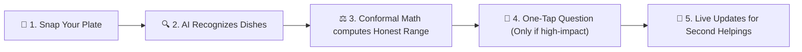
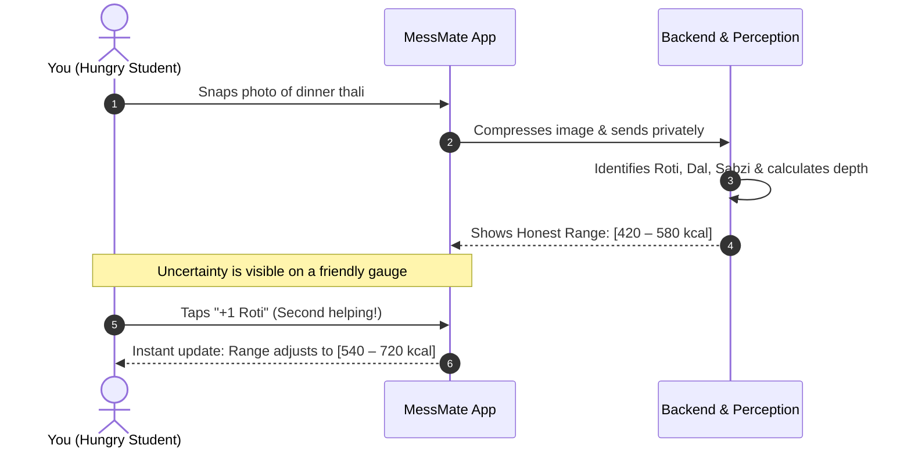

# MessMate: Honest Dietary Intelligence
> **Design Project - 1** | Course Codes: `E1CSA313` / `E1ITA306`  
> **Mentor:** Dr. M. Selvam | **Author:** HarshaVardhan BK

---

## The Big Idea: Why Calorie Apps Lie to Us

Most diet trackers pretend nutrition is simple arithmetic: you log a curry, and it confidently declares **"542 calories."** 

In the real world, that number is almost always wrong:
* **The Oil Blindspot:** A cook can add one extra splash of ghee and swing the meal by 150 calories without changing its visual appearance.
* **The Depth Illusion:** A flat phone camera cannot see whether a bowl is shallow or deep.
* **The Friction Wall:** Asking someone to weigh every single grain of rice guarantees they will quit within 4 days.

**MessMate** takes an honest, human-first approach. Instead of guessing a fake single number, it works like a thoughtful dietitian:
1. **Gives You an Honest Range:** Tells you `480 – 610 kcal (90% confident)`, not a false promise.
2. **Asks Only What Matters:** If knowing whether your curry had coconut milk shifts the estimate by 200 calories, it asks **one simple tap question**. If it doesn't matter, it leaves you alone.
3. **Understands Second Helpings:** Had another roti? Tap **`+1 Roti`** and the whole plate's probability range updates instantly.

---

## How It Works (At a Glance)



### The Human Journey



---

## What's Inside This Repository

This project contains both the **academic research deliverables** and the **complete, working software prototype**:

```
DP/
├── research/                  # The Academic & Scientific Foundation
│   ├── literature_review.md   # Systematic review of 20 verified papers (2022–2026)
│   ├── ppt-REV-2.pptx         # Defense & presentation slide deck (26 slides)
│   ├── papers/                # 20 verified peer-reviewed publications
│   ├── smart_meal_analyzer_paper_analysis_table.docx
│   └── visual_guides/         # Humanized architecture & tech stack diagrams
│
└── prototype/                 # The Production Software Prototype
    ├── backend/               # FastAPI core + DINOv2 vision + Conformal Bayesian engine
    │   ├── app/               # Services: nutrition, vision, conformal math, storage
    │   ├── static/            # Responsive web UI (mobile & desktop)
    │   └── tests/             # 156 comprehensive automated tests (100% passing)
    ├── android/               # Native Android WebView client (tested on Android 14)
    ├── mobile/                # Flutter cross-platform companion client
    └── run_phone_server.sh    # 1-click startup script for physical phone testing
```

---

## Quickstart: Run It in 2 Minutes

### 1. Start the Backend Server

```bash
cd prototype/backend

# Create virtual environment & install requirements
python3 -m venv .venv
source .venv/bin/activate
pip install -r pyproject.toml # or uv sync

# Start the server
uvicorn app.main:app --host 0.0.0.0 --port 8000
```

Open `http://localhost:8000` in your phone or browser to log in, snap a plate, or try a sample meal.

### 2. Run the Verification Tests

MessMate includes 156 unit and invariant tests covering everything from log-normal Monte Carlo math to privacy purges:

```bash
cd prototype/backend
pytest tests -q
# Output: 156 passed in ~11s (100% green)
```

### 3. Connect a Physical Android Phone

Connect your Android phone via USB with USB Debugging enabled:

```bash
# Forward traffic so the phone can reach your computer
adb reverse tcp:8000 tcp:8000

# Install & launch the debug APK
cd prototype/android
./gradlew installDebug
```

---

## Key Highlights & Innovations

* **Honest Conformal Uncertainty:** Instead of claiming pinpoint precision, MessMate uses conformal prediction to guarantee 90% statistical coverage on meal energy.
* **Zero Cognitive Fatigue:** Clarification questions are strictly limited to at most 3 per meal, and only asked when the Value-of-Information (VoI) exceeds 25 kcal.
* **Instant Refill Logic:** Re-running an entire visual pipeline when grabbing a second serving is frustrating. MessMate lets you tap a chip like `+½ Dal` to update your daily nutritional balance in milliseconds.
* **Private by Design:** Plate photos stay private and automatically purge after 30 days. No long-term biometric or personal photo harvesting.

---

## Academic Context

* **Course:** Design Project - 1 (`E1CSA313` / `E1ITA306`)
* **Department:** School of Computing & Information Technology
* **Institution:** Alliance University
* **Supervisor:** Dr. M. Selvam

*Licensed under the MIT License.*
